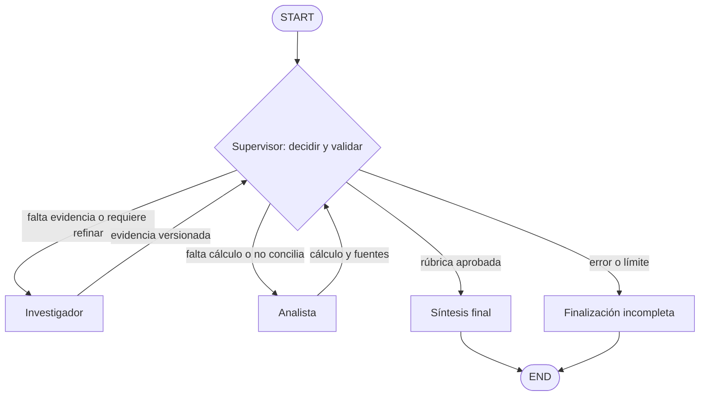

# Orquestador multi-agente especializado — Pre-entrega 6

Prototipo funcional en **Python + LangGraph** para investigar pilotos de automatización y calcular su ahorro de tiempo. Una consulta activa dos dominios: **recuperación de evidencia** y **validación/cómputo**, seguidos de una síntesis con fuentes.

**Demo entregada:** [notebooks/demo_delegacion.ipynb](notebooks/demo_delegacion.ipynb), ejecutable sin credenciales y con salidas guardadas. Muestra delegación normal, refinamiento de un análisis incorrecto y parada ante falta de evidencia.

> Los documentos y valores son ficticios, identificados como `simulado://`. La búsqueda es lexical sobre un corpus JSON local, una alternativa de búsqueda simulada propia; no es Tavily ni una base vectorial. No se presentan como datos reales ni como resultados de las pre-entregas anteriores.

## Topología y flujo



El grafo real puede consultarse con `build_graph().get_graph().draw_mermaid()`; [docs/graph.mmd](docs/graph.mmd) se genera desde el código. La topología jerárquica concentra el control y evita mensajes cruzados entre especialistas. El trabajo es secuencial porque el analista depende de la evidencia recuperada.

1. **Supervisor:** evalúa una rúbrica en cada visita y devuelve `next_agent`. La función `route` retorna `Literal['research', 'analyst', 'synthesis', 'stop']` y alimenta las aristas condicionales de `StateGraph`.
2. **Investigador:** sólo puede consultar `search_corpus`. Devuelve documentos con ID, fuente, datos y versión; no calcula resultados.
3. **Analista:** sólo puede usar `calculate_savings`. Valida identidad, duplicados, números finitos, tiempos y volumen. Conserva los IDs y la versión de investigación.
4. **Supervisor:** reconcilia todos los resultados con el cálculo de referencia. Un resultado inválido vuelve al especialista correspondiente.
5. **Síntesis:** produce una respuesta determinista con cifras verificadas, fuentes y límites. Sólo este nodo declara `task_completed=True`.

### Dos modos explícitos

| Modo | Supervisor | Especialistas | Red / credenciales |
|---|---|---|---|
| `offline` (predeterminado) | Política determinista según estado y rúbrica | Ejecutan sus herramientas en forma determinista | No requiere |
| `llm` | Modelo con salida estructurada `Decision` y prompt de supervisión | Prompts específicos y tool calling real, una herramienta por rol | OpenAI API y modelo compatible con structured output/tool calling |

El modo offline es un **workflow de agentes basado en reglas**, no una inferencia de IA. En modo LLM el modelo puede pedir nueva investigación o detener la tarea; la rúbrica ejecutable bloquea una síntesis prematura. La síntesis usa plantilla en ambos modos para evitar inventar cifras. La demo y las pruebas no equivalen a una validación con un proveedor real.

## Instalación y ejecución

Python **3.12 o superior** (verificado con 3.12). Desde la carpeta del repositorio:

```powershell
python -m venv .venv
.venv\Scripts\python.exe -m pip install -r requirements-dev.txt
.venv\Scripts\python.exe main.py
.venv\Scripts\python.exe main.py "Investiga los pilotos RPA de facturas y calcula el ahorro mensual" --output output/resultado.json
```

Para reproducir exactamente las versiones de la entrega, instalar `requirements-lock.txt` en lugar de `requirements-dev.txt`. Para sólo ejecutar la CLI, basta `requirements.txt`.

Resultado esperado para la consulta predeterminada: **256,67 → 66,67 horas/mes**, **190 horas ahorradas**, **74,03 %** de reducción ponderada. La traza muestra `supervisor → research → supervisor → analyst → supervisor → synthesis`.

### Modo LLM opcional

Configurar variables de entorno en una sesión local segura:

```powershell
$env:OPENAI_API_KEY = "<tu clave local>"
$env:OPENAI_MODEL = "<modelo con structured output y tool calling>"
.venv\Scripts\python.exe main.py --mode llm
```

`.env.example` es una referencia; el programa **no carga `.env` automáticamente**. No incluir claves en Git, capturas o notebooks. Cada llamada tiene timeout de 30 segundos y un reintento del cliente. Las llamadas consumen cuota del proveedor. El modo LLM envía la consulta al proveedor y la evidencia simulada al analista; sustituir el corpus por datos sensibles requiere revisar esa transferencia. No se necesitan claves para corregir o evaluar esta entrega.

## Estado, contexto y conflictos

`State` hereda de `MessagesState` y agrega `query`, `research`, `analysis`, `next_agent`, `steps`, `issues`, `error`, `task_completed` y `final_answer`.

- `contributions` usa un reducer acumulativo `Annotated[list[Contribution], add]`: conserva agente, paso y detalle de cada aporte en lugar de sobrescribirlo.
- `research.version` y `analysis.research_version` impiden reutilizar un cálculo sobre evidencia antigua. Una investigación nueva invalida el análisis anterior.
- Sólo el investigador escribe investigación y sólo el analista escribe análisis. No hay escrituras concurrentes sobre esos canales; las contribuciones admiten acumulación. La ejecución entregada no lanza ramas asíncronas paralelas.
- Los modelos no reciben todo el historial: el router ve consulta, rúbrica y paso; el investigador recibe consulta y feedback; el analista recibe únicamente los documentos. `messages` conserva la solicitud y la respuesta final.
- Si el modelo y la rúbrica discrepan, prevalece la validación ejecutable. Si el analista intenta modificar los documentos al llamar la herramienta, se rechaza la operación.
- La rúbrica verifica fuentes/IDs, dominio numérico, versión, filas, totales y porcentaje. No certifica la verdad de documentos externos; en este alcance los documentos son simulados.

## Cálculos y reglas del prototipo

Por documento: `horas iniciales = minutos iniciales × volumen mensual / 60`; `horas finales = minutos finales × volumen mensual / 60`; `ahorro = iniciales − finales`.

Porcentaje global: `sum(ahorro) / sum(horas iniciales) × 100`. No se promedian porcentajes individuales. Se requieren tiempos iniciales positivos, tiempos finales entre cero y el tiempo inicial y volumen entero positivo. No se convierten horas en dinero. Los volúmenes y tiempos se consideran constantes, un supuesto explícito de la demo.

## Errores y condiciones de parada

- `--max-steps` limita visitas al supervisor (3 a 30; predeterminado 8). Al superar el presupuesto se pasa a `stop`; además existe `recursion_limit=100` como segunda barrera.
- Evidencia ausente o cálculo insuficiente permite refinamiento hasta ese límite. Errores técnicos de especialistas o del proveedor finalizan de forma controlada; no se reintenta indefinidamente.
- La CLI retorna **0** si completó y **2** si terminó incompleta. La validación de argumentos también falla explícitamente.
- Los logs técnicos guardan nodo/paso/tipo de error y omiten contenido y mensajes remotos. La salida de consola y el JSON solicitado sí contienen consulta y resultados: tratarlos según su sensibilidad.
- No hay efectos externos de negocio: repetir el cálculo no duplica registros. La salida JSON explícita sobrescribe el archivo elegido. No hay persistencia de ejecución ni recuperación tras apagar la computadora; se vuelve a ejecutar desde el inicio.

## Verificación y demo

```powershell
.venv\Scripts\python.exe -m pytest -q
.venv\Scripts\python.exe -m ruff check .
.venv\Scripts\python.exe -m pip check
.venv\Scripts\python.exe scripts/build_demo.py
```

El último comando construye y ejecuta el notebook completo y actualiza el Mermaid real. También se puede abrir el notebook con Jupyter o VS Code, seleccionar el entorno `.venv` y ejecutar todas las celdas. Las pruebas cubren flujo normal, cálculo esperado, refinamiento, evidencia ausente, límite de pasos, errores de herramienta, estado obsoleto, valores inválidos, duplicados, contexto acotado y modo LLM con transporte simulado. GitHub Actions ejecuta estas mismas verificaciones y el notebook.

## Estructura

```text
state.py                    # contrato del estado y reducers
tools.py                    # búsqueda local y cálculo validado
agents/research_agent.py    # investigador
agents/analyst_agent.py     # analista
agents/supervisor.py        # rúbrica y router
agents/tool_agent.py        # invocación acotada para modo LLM
graph.py                    # StateGraph, síntesis, parada y límites
main.py                     # CLI y configuración
data/corpus.json            # evidencia ficticia versionable
notebooks/demo_delegacion.ipynb
scripts/build_demo.py
tests/test_orchestrator.py
docs/graph.mmd
```

## Alcance y extensiones

El dominio implementado es investigación de pilotos RPA y ahorro de tiempo; no responde investigación general ni consulta internet. El corpus recupera por coincidencia de palabras, por lo que una consulta fuera del dominio o con vocabulario no presente puede no encontrar evidencia. Los tres documentos son independientes, con volúmenes mensuales comparables; no se deduplican procesos por similitud semántica. La jerarquía, las herramientas y el estado funcionan sin reutilizar proyectos previos.

Para producción: reemplazar el corpus por una fuente autorizada, agregar autenticación y validación de procedencia, persistencia con identificador de ejecución, recuperación, evaluación de relevancia y observabilidad con retención de datos definida. Estas capacidades quedan fuera del prototipo.

Referencia de implementación: [StateGraph y aristas condicionales, documentación oficial de LangGraph](https://reference.langchain.com/python/langgraph/graph/state/StateGraph/add_conditional_edges).
